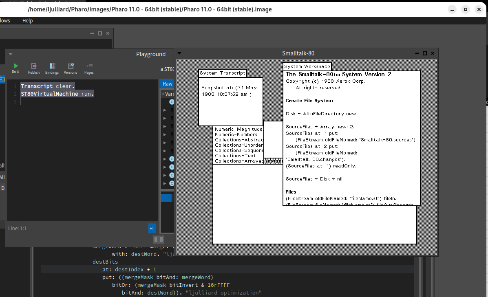

# Smalltalk-80 by the Book

This project is about delivering the promise of the book "Smalltalk-80: The Language and its Implementation" (also known as the "Blue Book") as published by Xerox PARC in 1983. That is, implementing and running the complete Smalltalk-80 virtual machine and its environment using only the Smalltalk language itself. Want to know more about the background of this project? Read our [bits of history](doc/History.md).

In carrying out this project, my aim was twofold. First, to show that the specification written in Smalltalk in 1983 was perfectly functional. And it is! Second, to gather into this project's source code all the corrections and errata published over the 40+ years since its original design at Xerox PARC. This work remains, even today, a remarkable technical reference for anyone who wants to understand how a virtual machine works.

# Status
This project that I started in June 2020 during the COVID confinement is pretty much complete and stable (as of Nov 2026). It has been thoroughly tested with a suite of 400+ tests covering both the interpreter and the object memory manager. 


# Installation
* Install the Smalltalk [Pharo](https://www.pharo.org/) environment
* Run the Pharo launcher, install the Pharo image (version 11 or above) and launch it.
* Click on the `Sources > Git repositories browser` menu and then the "+ Add" button
* Choose the "Clone remote repository" option
* In the Remote URL field  copy-paste this git repo URL  : `https://github.com/ljulliar/smalltalk-80-sources.git`and select the local directory of your choice where to clone the git repo (let's call it 'local_path' for future reference)
* Right-click on the `Smalltak-80 Sources` entry in the Repositories window and select `Packages`
* Right-click on the `Smalltalk-80 VM' package and select `Load`
* Click on the `Browse > Playground` menu
* In the Playground window type :
```
ST80VirtualMachine runWithImagePath: 'local_git_path/assets' keyboard: 'XX'.
```
where local_git_path is where you created your local git repo and XX is your host keyboard layout (for now only 'US' (US international) and 'FR' (French) keyboards are supported).  
* Right click in the Playground and Do It. Et voilà! 

# Smalltalk-80 at work
But does it actually work ? the answer is yes it does :-) As seeing is believing, here is a screenshot of the ST-80 VM running for real in my Smalltalk Pharo environment. 


The Smalltalk-80 startup screen that you see here is exactly as presented in the 1983 Blue Book _Smalltalk-80: The Language and Its Implementation
By Adele Goldberg and David Robson_. Notice the date of the VM image in the System Transcript window. Using your own machine keyboard and mouse you can interact with the environment: browse the class hierachy and its sources, execute some Smalltalk-80 code in a Workspace...

Mouse buttons mapping:
* left click is the Smalltalk-80 red button (select)
* right click is the yellow button (menus, do it, print it)
* Cmd/Alt/Ctrl + left click is the blue button (window menu: under, move, frame, collapse, close). To move a window, blue-click its title bar and choose `move`, then click to drop it.

# The assets directory
The `assets` directory holds everything the VM needs to boot a Smalltalk-80 environment:

| File | Origin | Purpose |
|---|---|---|
| `Smalltalk-80.image` | Xerox PARC 1983 distribution (via Mario Wolczko) | The original, pristine virtual image. |
| `Smalltalk-80.sources` | Xerox PARC 1983 distribution (via Mario Wolczko) | Source code of all system methods, read by the browsers. |
| `Smalltalk-80.changes` | Dan Banay | Changes log of the environment. Its content is appended to when you accept code. |
| `snapshot.im` | Dan Banay | A snapshot of the image with the `PosixFile`, `PosixFileDirectory` and `PosixFilePage` classes and a bootstrapped `SourceFiles`, so that the guest file system (`FileStream`, source browsing, change logging) works on the host disk. This is the file loaded at startup. |
| `class.oops`, `method.oops` | This project | Lists of class and method oops used by the VM to find well-known objects in the original image. |

The guest file system is served by the host through the file primitives implemented in `ST80FileSystem`: the files of the `assets` directory are the ones the guest sees.

# Saving your session
To save your work, right-click on the Smalltalk-80 desktop background and select `save`. The whole environment is written to `snapshot.im` in the `assets` folder, **replacing** the one shipped with the project.

At startup the VM loads `assets/snapshot.im` if it exists and falls back to the original `Smalltalk-80.image` otherwise (in which case the guest file system classes are missing). To go back to the shipped environment, restore `snapshot.im` with `git checkout assets/snapshot.im`.

# Developer notes
If you feel like contributing your time and talent to this project, pick any item in this [TODO](doc/TODO.md) list or any other task of your choice. All contributions, be it bug reports, code fixes, missing features, improved documentation, etc., are very welcome.

You will find some guidelines and relevant instructions in the [Developer Notes](doc/DEVELOPER.md)

# Licenses
The code of the Smalltalk-80 VM used in this project (both the Interpreter and the Object memory classes) as published by Xerox PARC in 1983 is owned by Adele Goldberg.

The rest of the code (the primitives, the hardware abstraction layer, the POSIX file system mapping) is copyright Laurent Julliard, 2020-2026 and distributed under GPL 3.0 .

# Credits
I'd like to thank a number of people whose prior work made this project possible:
* The Blue Book by Adele Goldberg and Dave Robson (available [here](http://stephane.ducasse.free.fr/FreeBooks/BlueBook/Bluebook.pdf) in its original 1983 edition, courtesy Stéphane Ducasse)
* The [Pharo](https://www.pharo.org/) developers community for providing this remarkable Open Source Smalltalk environment
* [Dan Banay's Smalltalk-80 VM](https://github.com/dbanay/Smalltalk) project, a C++ implementation of the same VM, that proved very helpful when I started debugging my Smalltalk implementation. The `snapshot.im` and `Smalltalk-80.changes` files of the `assets` directory are his work, taken from his repository and redistributed under his MIT license (see `assets/LICENSE-dbanay.txt`). Many thanks, Dan!
* Dwight Hughes and Eliot Miranda for providing in plain text the [5 chapters of the Blue Book](http://www.mirandabanda.org/bluebook/bluebook_imp_toc.html) covering the Smalltalk-80 specifications and implementation.
* And last but not the least, [Mario Wolczko Smalltalk-80 web page](http://www.wolczko.com/st80/) for putting together critical files that one absolutely needs to run the full Smalltalk environment, most notably the Virtual Machine image as published (on tapes!!) by Xerox Parc in 1983.

